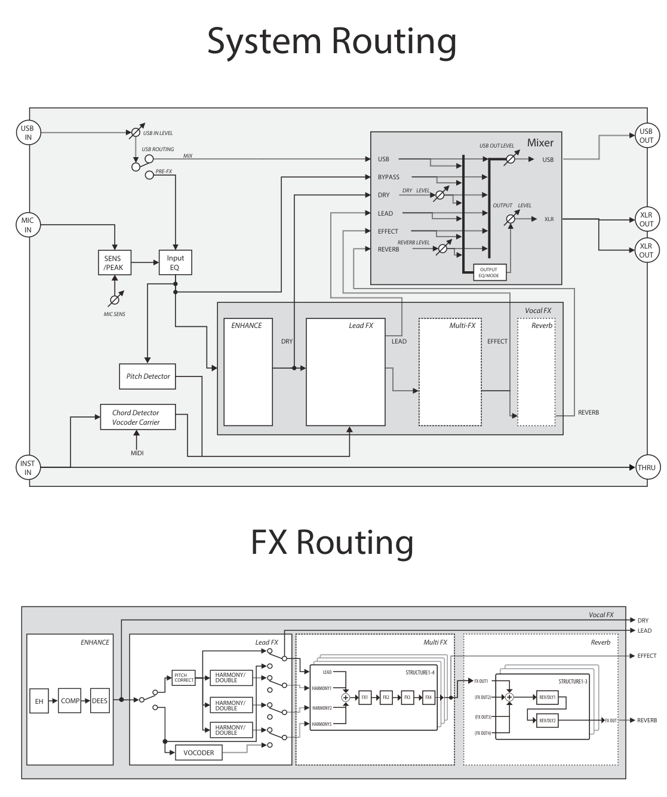

# Boss VE-500 — Field Notes

Practical notes on how the VE-500's signal flow, output modes and level controls
actually fit together. These fill in the gaps the official manuals leave out. They
were written while working through the manuals with real use in mind (guitar +
vocal, splitting outputs to a mixer/DAW, MIDI control).

**Sources** (same folder):
- [Owner's Manual](Boss-VE-500-Owners-Manual.md) — cited as **OM p.N**
- [Parameter Guide](Boss-VE-500-Parameter-Guide.md) — cited as **PG p.N**
- [Editor manual](Boss-VE-500-Editor.md), [MIDI Implementation](Boss-VE-500-MIDI-Implementation.md)
- Routing diagrams, PG p.31: [Boss-VE-500-Routing-p31.png](Boss-VE-500-Routing-p31.png) (rendered from the PDF; the
  converted `.md` text of these diagrams is jumbled, so use the image)

**How much to trust each claim.** Each claim is marked with one of:
- ✅ **Manual** — stated in the manual text.
- 📐 **Diagram** — shown in the PG p.31 routing diagram.
- 🔶 **Inferred** — worked out from the wording or diagram, but not shown or stated directly.
- 🧪 **Test** — should be checked on the unit. See the [test list](#tests-to-run-on-the-unit).

---

## 1. Signal flow — read from the PG p.31 diagrams



### System routing — three stages

The unit is three stages in a row. The effects don't feed the outputs directly.
**Everything lands in a mixer first**, and the mixer builds the XLR and USB outputs:

```
 ┌─ 1. INPUT ──────────┐    ┌─ 2. VOCAL FX (the patch) ──────────────────────┐    ┌─ 3. MIXER (system settings) ─┐
 │ MIC ─► MIC SENS     │    │                                                │    │                              │
 │     ─► INPUT EQ ─┬──┼────┼──────────────────────────────────── BYPASS ────┼───►│                              │
 │                  ├──┼─► PITCH DETECTOR ─┐                                 │    │                              │
 │                  └──┼─► ENHANCE ─┬──────┼────────────────────── DRY ──────┼───►│  6 inputs → 2 buses          │
 │                     │    │       └─► LEAD FX ─┬──────────────── LEAD ─────┼───►│  (XLR bus + USB bus)         │──► XLR OUT L/R
 │ INST ─► CHORD DET.──┼────┼─────────────►┘     └─► MULTI-FX ─┬── EFFECT ───┼───►│                              │──► USB OUT
 │      └► INST THRU   │    │                                  └─► REVERB ───┼───►│                              │
 │ USB IN ─(MIX)───────┼────┼────────────────────────────────────── USB ─────┼───►│                              │
 │        └(PRE FX)─► INPUT EQ                                             │    │                              │
 └─────────────────────┘    └────────────────────────────────────────────────┘    └──────────────────────────────┘
```

📐 The Input EQ output splits **three ways in parallel**: BYPASS, ENHANCE and PITCH DETECTOR.

### Stage 3 — the Mixer (PG p.31, top right of the System Routing diagram)

```
                      fader            ┌─ XLR bus ─► OUTPUT EQ/MODE ─► [OUTPUT LEVEL] ─► XLR OUT L + R
 USB    ──────────────────────────┬────┤
 BYPASS ──────────────────────────┤    │
 DRY    ──────[DRY LEVEL]─────────┤    │  every input feeds BOTH buses
 LEAD   ──────────────────────────┤    │
 EFFECT ──────────────────────────┤    │
 REVERB ──────[REVERB LEVEL]──────┴────┴─ USB bus ─► [USB OUT LEVEL] ─► USB OUT
```

The mixer is where the **system** settings act. Everything in stage 2 is **patch** settings:
- **OUTPUT MODE** (in the OUTPUT EQ/MODE block) decides which mixer inputs go to XLR L and R.
- **OUTPUT EQ** is a final EQ on the XLR bus only.
- **DRY LEVEL** and **REVERB LEVEL** are faders on two of the six inputs.
- **OUTPUT LEVEL** is the XLR master. **USB OUT LEVEL** is the USB master.
- 📐 **The USB bus skips OUTPUT EQ/MODE**, so OUTPUT EQ and MODE don't apply to USB OUT.

**The mixer has six inputs**, and each one feeds both the XLR bus and the USB bus 📐:

| Input | Contents | Source |
|---|---|---|
| **USB** | Audio from the computer (when USB ROUTING = MIX) | 📐 + ✅ [PG USB](Boss-VE-500-Parameter-Guide.md#L2264) |
| **BYPASS** | Mic after **MIC SENS + INPUT EQ**, before ENHANCE. *Not* a raw mic: input EQ, the notch filter and low/high cuts still apply | 📐 |
| **DRY** | Mic after ENHANCE (enhancer → comp → de-esser + EQ). **No pitch correction**, no FX, no reverb. Passes through the **DRY LEVEL** fader | 📐 + ✅ PG p.24 |
| **LEAD** | Lead vocal leaving Lead FX: **pitch-corrected** (HARMONY type), **before** Multi-FX, no harmonies, no reverb | 📐 |
| **EFFECT** | Multi-FX output: lead + HARMONY1–3 (or vocoder) through FX1–4 | 📐 |
| **REVERB** | Reverb section output (100% wet return). Passes through the **REVERB LEVEL** fader | 📐 |

The tuner's VOCAL OUT options pick from these same inputs (✅ OM p.8, PG p.29):
- BYPASS: effects off.
- DRY: ENHANCE applied.
- LEAD: ENHANCE + PITCH CORRECT.
- MUTE: no output.

### FX routing (inside Vocal FX)
```
ENHANCE: EH ─► COMP ─► DEES ─┬─────────────────────────────────────────────────► DRY
                             └─► [HARMONY | VOCODER] switch
   HARMONY ─► PITCH CORRECT ─┬───────────────► LEAD slot ─┬──────────────────────► LEAD
                             ├─► HARMONY/DOUBLE ─► HARMONY1 slot                  │
                             ├─► HARMONY/DOUBLE ─► HARMONY2 slot                  ▼
                             └─► HARMONY/DOUBLE ─► HARMONY3 slot ─► MULTI-FX (STRUCTURE1–4: LEAD + H1–3 ─► FX1–4)
   VOCODER ─┬─(uncorrected)──► LEAD slot                          ─┬─► EFFECT
            └─► VOCODER ─────► HARMONY3 slot (H1, H2 empty)         └─► REVERB (FX OUT1–4 ─► STRUCTURE1–3 ─► REV/DLY1–2) ─► REVERB
```

What this settles:
- 📐 **"Pitch correction only when HRM is selected" means the LFX TYPE switch.** The
  switch after ENHANCE sends the voice either through PITCH CORRECT (HARMONY type) or
  around it (VOCODER type) ([OM p.11](Boss-VE-500-Owners-Manual.md), [PG p.5](Boss-VE-500-Parameter-Guide.md#L371)).
  PITCH CORRECT has its own ON/OFF ✅ [PG p.5](Boss-VE-500-Parameter-Guide.md#L308).
  - ✅ **Tested on the unit (2026-10-02):** it works with the [HARMONY] switch off. You can use pitch correction alone, with no harmony voices.
- 📐 **Pitch correction feeds the lead and all three HARMONY/DOUBLE blocks.** Every voice
  in EFFECT and LEAD, and therefore the reverb, is built from the corrected voice.
  - Only **BYPASS** and **DRY** (and USB) skip it.
- 📐 **The Pitch Detector reads the voice after the Input EQ, before ENHANCE and pitch correction.**
  - The harmony engine *detects* your real (uncorrected) pitch.
  - The harmony *audio* is shifted from the corrected voice.
- 📐 **In VOCODER mode the LEAD slot carries the uncorrected, enhanced voice.** The vocoder
  sits in the HARMONY3 slot, and HARMONY1/2 are empty.
- 📐 **Reverb is a parallel send/return.** It's fed from the Multi-FX output (FX OUT1–4
  per structure) and returns as its own mixer input. EFFECT carries the dry-of-reverb
  signal, and REVERB LEVEL is the return fader.
- 📐 **The guitar never reaches the mixer.** INST IN only feeds THRU and the chord
  detector / vocoder carrier ✅ OM p.3.
- **No FX STRUCTURE setting moves pitch correction downstream.** Structures only change
  what happens inside Multi-FX and Reverb ([OM p.12](Boss-VE-500-Owners-Manual.md), [PG p.16](Boss-VE-500-Parameter-Guide.md#L1059)).

---

## 2. OUTPUT → MODE (system setting)

✅ [PG p.24](Boss-VE-500-Parameter-Guide.md#L1745). The first name in each mode is **L** and the second is **R**. The manual states this explicitly.

| Mode | OUTPUT L | OUTPUT R | Use for |
|---|---|---|---|
| **STEREO** | Main mix, L | Main mix, R | Normal stereo to PA/interface |
| **DUAL MONO** | Mono mix | Mono mix | Two feeds (FOH + monitor/recorder) |
| **FX/BYPASS** | Effect sound | BYPASS (mic after input EQ) | Safety channel / record clean, reprocess later |
| **FX/DRY** | Effect sound | DRY (after ENHANCE) | Clean-but-polished channel for FOH/DAW |

Notes:
- 🔶 The "main mix" is presumably EFFECT + REVERB (after REVERB LEVEL) + DRY (after DRY LEVEL).
  The diagram shows all six inputs reaching the OUTPUT EQ/MODE block, but not which ones each mode uses.
- 🔶 **The LEAD input isn't offered by any OUTPUT MODE.** The only documented use is the
  tuner's VOCAL OUT = LEAD. A "pitch-corrected lead only" output isn't available from the XLRs.
- 🔶 In FX/BYPASS and FX/DRY, **L is effectively mono**. Harmony panning and stereo
  delays are folded into one jack.
- 🔶 DUAL MONO: the manual only says "Output mono from the OUTPUT L, R jacks
  respectively". It's almost certainly the same summed signal on both. 🧪 Test T5. Don't feed
  both jacks into a stereo pair; that's the same signal twice (+6 dB, no width).
- **The R channel in FX/BYPASS still has the input EQ on it.** For a truly flat safety
  channel, set INPUT → EQ SET = OFF ([PG INPUT](Boss-VE-500-Parameter-Guide.md#L1700)). Doing this changes
  every signal, because the input EQ is upstream of everything.
- Guitar is never on OUTPUT L/R.

---

## 3. Level controls — what scales what

### Mixer faders (system)
✅ [PG p.24](Boss-VE-500-Parameter-Guide.md#L1745) and 📐

| Control | Range | Controls | Does **not** touch |
|---|---|---|---|
| **OUTPUT LEVEL** | 0–200 | The whole XLR bus, after OUTPUT EQ/MODE | USB OUT |
| **REVERB LEVEL** (`REV LEVEL`) | 0–200 | The REVERB return, all patches | Multi-FX, lead, harmony, FX-slot reverbs 📐 |
| **DRY LEVEL** | 0–100 | The DRY input into the mixer | The R jack in FX/DRY ✅ (manual note) |
| **USB OUT LEVEL** / **USB IN LEVEL** | 0–200 | The USB bus out / the computer audio in | XLR |

- **Multi-FX (FX1–4) has no system fader.** Its level is set inside the patch (each FX's
  E.LEVEL/D.LEVEL, harmony levels, MASTER PAT LEVEL), then by OUTPUT LEVEL.
- 📐 vs ✅ **Minor discrepancy.** The diagram draws DRY LEVEL before the split to both
  buses, but the manual says it doesn't affect the DRY jack in FX/DRY. 🔶 The MODE block
  probably takes DRY from before the fader for that mode.
- 🔶 **DRY LEVEL adds a second, *uncorrected* copy of your voice** next to the
  corrected lead already in EFFECT. That thickens the vocal and blurs pitch correction.
  For a tight corrected sound, keep it low and set the lead volume with **harmony D.LEVEL**
  ([PG p.6](Boss-VE-500-Parameter-Guide.md#L382)) instead. 🧪 Test T3.

### Name collisions to watch
- **D.LEVEL** on harmony and FX units is the direct (unprocessed by *that unit*)
  part of that block's own output. It is **not** the mixer's DRY LEVEL.
- **"Reverb"** as a section name covers **REV1/REV2**, and each of those can be
  AMBIENCE / ROOM / HALL / PLATE / MOD **or DELAY** ([PG REV TYPE](Boss-VE-500-Parameter-Guide.md#L938)).
  That's why OM calls them "REVERB/DELAY units".
- **FX1–4 also offer REVERB and DELAY types.** 📐 These sit inside Multi-FX, upstream of
  the reverb send, so they're part of EFFECT and **REVERB LEVEL doesn't affect them**.
  → Keep reverbs in REV1/2 if you want one control to dry out every patch.

### The three reverb levels
| Control | Where | Range | Scope |
|---|---|---|---|
| **REV1 / REV2 LEVEL** (DELAY type: E.LEVEL 0–120) | Each REV unit | 0–100 | That unit, this patch |
| **MASTER → REVERB LEVEL** | MST | 0–200 | Whole reverb section, this patch ✅ [PG p.16](Boss-VE-500-Parameter-Guide.md#L1059) |
| **OUTPUT → REV LEVEL** | MENU, mixer return fader 📐 | 0–200 | Reverb return, **all patches** ✅ PG p.24 |

🔶 They combine like a chain of faders. MASTER REVERB LEVEL isn't drawn in the
diagram; it's presumably the reverb section's output level inside the patch.

```
REV1 LEVEL ┐
           ├─(REVERB STRUCTURE)─► × MASTER REVERB LEVEL ─► REVERB return ─► × OUTPUT REV LEVEL ─► mixer
REV2 LEVEL ┘
```

- 🔶 On the 0–200 controls, **100 = unchanged** and above 100 boosts. The manual says
  this for LOOP LEVEL ([PG LOOP](Boss-VE-500-Parameter-Guide.md#L1038)) but not for these. 🧪 Test T6.
- 📐 In SERIES structure, REV/DLY1 feeds REV/DLY2. 🔶 REV1 LEVEL probably also changes
  how much signal REV2 receives.

**Working rule:**
1. Use REV1/2 LEVEL for the sound of the reverb.
2. Use MASTER REVERB LEVEL to balance reverb against the vocal in each patch.
3. Leave OUTPUT REV LEVEL at 100 and change it only for a particular room or engineer.

---

## 4. Controlling reverb from MIDI / pedal

- ✅ ASSIGN 1–8 can take **CC#1–31 / 64–95** as a source ([PG ASSIGN](Boss-VE-500-Parameter-Guide.md#L1211)).
- ✅ Available targets ([PG Target List p.20+](Boss-VE-500-Parameter-Guide.md#L2066)):
  - `R1REV LV` / `R2REV LV`: unit levels
  - `R1DLY ELV` / `R2DLY ELV`: unit levels when set to DELAY
  - `MASTER REVERB LEV`
  - `OUTPUT REV LEVEL` (shown as `REVERB LV`)
  - `OUTPUT DRY LEVEL`
- There's **no fixed CC map**. Receiving a CC needs an ASSIGN slot, and **ASSIGN is
  per patch**. A CC aimed at the global OUTPUT REV LEVEL still needs an ASSIGN slot in
  every patch, so choosing the global target saves no setup.
- ✅ **Simplest on-pedal option:** CTL & ASSIGN → **EXP → FUNC = REV LEVEL** with MIN/MAX,
  no ASSIGN slot needed ([PG EXP](Boss-VE-500-Parameter-Guide.md#L1188)).
  **PREF → EXP = SYSTEM** shares that pedal setup across all patches ([PG p.28](Boss-VE-500-Parameter-Guide.md#L2150)).
  🔶 The manual doesn't say which REV LEVEL this FUNC controls; probably MASTER.

**Recommended:** use MIDI or the pedal to move **MASTER REVERB LEV**, not OUTPUT REV LEVEL.

| | MASTER REVERB LEV | OUTPUT REV LEVEL |
|---|---|---|
| After a patch change | 🔶 Goes back to the stored value | Stays where you left it |
| Saving | Only if you write the patch | ✅ System settings "saved and applied automatically" (OM p.16) |
| Risk | Low | You leave it at 0 and later patches are dry, possibly even after a restart |

Setup: in the ASSIGN slot set **SOURCE = CC#**, **TARGET = MASTER REVERB LEV**, and
**MIN/MAX** to the useful range (e.g. 0–150). Build it once, then copy it to the other
patches with the [VE-500 Editor](Boss-VE-500-Editor.md).

✅ **PREF → REVERB = PATCH/SYSTEM** can make all patches share one reverb setup
([PG p.28](Boss-VE-500-Parameter-Guide.md#L2150)). 🔶 The manual doesn't say whether MASTER REVERB LEVEL is included.

---

## 5. Harmony pitch behaviour (ACCURACY)

✅ [PG p.6](Boss-VE-500-Parameter-Guide.md#L382). ACCURACY 0–10: *"Raising this value makes the pitch of the harmony
more closely match the pitch of the original vocal. With the higher value, the
harmony is sounded at the precise pitch; this means that if the pitch of the
original vocal is not precise, the result might not sound harmonious."*

The wording supports two opposite readings, so 🧪 **Test T2 decides it**:

| Reading | ACCURACY 10 | ACCURACY 0 |
|---|---|---|
| **A: accurate to the incoming voice** (fits the first sentence) | Harmony tracks your exact pitch, drift included. In tune with you, maybe not with the band | Harmony settles on the intended scale note, like pitch correction |
| **B: accurate to the scale** (fits "precise pitch") | Harmony snaps to the correct note. Clashes if you're off | Harmony follows your drift |

Either way, one end keeps the harmony **in tune with you** and the other keeps it
**in tune with the key**. Choose based on how steady your pitch is.

📐 **The Pitch Detector is fed from before pitch correction.** ACCURACY therefore works
from your real sung pitch even when PITCH CORRECT is on. The harmony audio, though,
is shifted from the corrected voice. Turn PITCH CORRECT off when testing ACCURACY, so the
two don't mask each other.

Related settings ([PG p.6](Boss-VE-500-Parameter-Guide.md#L382)):
- **KEY / AUTO** (FULL / HYBRID / OFF) decide whether "+3rd" is major or minor at each scale degree. For a minor key, use the relative major (A minor → C) ✅ OM p.14.
- **METHOD** (SCALE1–2 / CHORD1–2) biases the harmony toward the key or toward the chord you're playing.
- **VIBRATO** (-10…+10): negative values make the harmony steadier than your voice.
- **DOUBLE** (OFF / LIGHT / NORMAL / DEEP) 📐 lives inside each HARMONY/DOUBLE block, not as a separate effect. **UNISON** is a voice type.

---

## 6. Recipe: corrected harmonies, natural lead

Structure can't do this (§1): 📐 pitch correction feeds the lead slot *and* all harmony blocks. Options:

1. **Pitch correction off, use ACCURACY (simplest).** Keep PITCH CORRECT off and set
   the end of ACCURACY that locks the harmony to the key (see §5). FX and reverb stay
   on both the lead and the harmonies, and no output tricks are needed.
2. **Separate channels (most flexible).**
   - PITCH CORRECT on.
   - **Harmony D.LEVEL = 0** to take the corrected lead out of Multi-FX.
   - **OUTPUT MODE = FX/DRY** and **DRY LEVEL = 0**.
   - L = corrected harmonies + FX + reverb. R = natural lead (ENHANCE only).
   - Balance them and add reverb to the lead at the mixer/DAW. The harmonies lose stereo.
3. **One mixed output.**
   - PITCH CORRECT on, harmony D.LEVEL = 0.
   - **OUTPUT DRY LEVEL up** to make the natural voice the lead.
   - Mode STEREO or DUAL MONO.
   - 📐 Catch: DRY goes straight to the mixer, skipping FX1–4 and REV1/2, so the lead is
     completely dry. DRY LEVEL is also a system setting, so it affects every patch.

🔶 Options 2–3 assume harmony D.LEVEL sets the LEAD slot's level into Multi-FX (the
diagram doesn't draw it). 🧪 Test T3.

---

## 7. USB — record raw, reprocess later

✅ [PG USB](Boss-VE-500-Parameter-Guide.md#L2264) and 📐:

| Setting | Values | What it does |
|---|---|---|
| **IN LEVEL / OUT LEVEL** | 0–200 | Level from / to the computer |
| **ROUTING = MIX** | | Computer audio goes into the mixer (playback / monitoring) |
| **ROUTING = PRE FX** | | Computer audio goes into the **Input EQ → effects**, processed like the mic |
| **LOOP BACK** | OFF / ON | Mixes computer audio with the VE-500 and returns it to the computer. Disables ROUTING |
| **DIRECT MON** | OFF / ON | ON: VE-500 sound goes to the OUTPUT jacks. OFF: only USB input is output (use when the DAW "thru's" the audio). Not saved; always ON at power-up |

**Re-amping workflow:**
1. Record the vocal clean, via FX/BYPASS R or USB.
2. Later, play it back with **ROUTING = PRE FX** and try different patches on the take.
3. 🔶 Harmony needs chord info. With AUTO = FULL/HYBRID, play the guitar part live
   into INST IN during the re-amp, send MIDI notes, or set AUTO = OFF with a fixed KEY.

📐 USB OUT is its own mixer bus (all six inputs feed it) with its own level. The guide
doesn't document a way to choose which inputs go to USB versus XLR.

---

## 8. ENHANCE — what the manual does and doesn't tell you

✅ [PG p.4](Boss-VE-500-Parameter-Guide.md#L276). 📐 Order inside the block: **EH → COMP → DEES**.
The EQ isn't drawn; 🔶 it's presumably at the end of the block.

| Part | Controls | Frequency info in the manual |
|---|---|---|
| Enhancer | ENHANCE 0–100 ("more sharply defined") | **None** |
| Compressor | COMPRESS 0–100 | Depth only: no threshold, ratio, attack or release |
| De-esser | DE-ESSER 0–100 | **None** (sibilance band not given) |
| EQ | LOW/HIGH GAIN ±20 dB (shelf frequencies not given); LMID/HMID gain ±20 dB, FREQ 20 Hz–16 kHz, Q 0.5–16; LOW CUT FLAT/20–800 Hz; HIGH CUT 630 Hz–16 kHz/FLAT; LEVEL ±20 dB | Only the mid bands and cut filters |

🧪 To find the actual enhancer and de-esser bands, measure them (Test T7).

---

## Tests to run on the unit

| # | What it checks | Procedure | What the result means |
|---|---|---|---|
| T1 | Pitch correction works with harmony off | PITCH CORRECT = ROBOT, toggle [HARMONY] | ✅ **Done 2026-10-02: PC works with harmony off.** |
| T2 | Which way ACCURACY works | PC off; one voice +3RD, AUTO OFF, key set; ACCURACY 10, bend a held note slowly sharp; repeat at 0 | Harmony bends smoothly with you at 10 → reading A. Holds then jumps → reading B |
| T3 | Harmony D.LEVEL is the lead into Multi-FX | PC = ROBOT, harmony D.LEVEL 0, DRY LEVEL up | Natural lead over robotic harmonies → confirmed |
| T4 | REVERB LEVEL ignores FX-slot reverbs (📐 already shows this) | REV1/2 off, REVERB in FX3; OUTPUT REV LEVEL → 0 | Reverb still audible → confirmed by ear |
| T5 | DUAL MONO jacks are identical | Both jacks into the interface, hard-panned harmony patch | Both channels identical → either jack works alone |
| T6 | 100 is unity on the 0–200 reverb levels | MASTER REVERB LEVEL 100 vs 0 vs 200 | 200 clearly louder than the unit level alone → 100 is unity, above boosts |
| T7 | ENHANCE frequency behaviour | Comp/de-ess/EQ flat; pink noise or steady vocal; record ENHANCE 0 vs 100 and compare in a spectrum analyser (Logic MultiMeter, SPAN). Repeat with DE-ESSER 100 on sibilant material | Shows where the enhancer and de-esser act |

When a test is done, update the matching 🔶 marker above to ✅ (or correct the claim).
