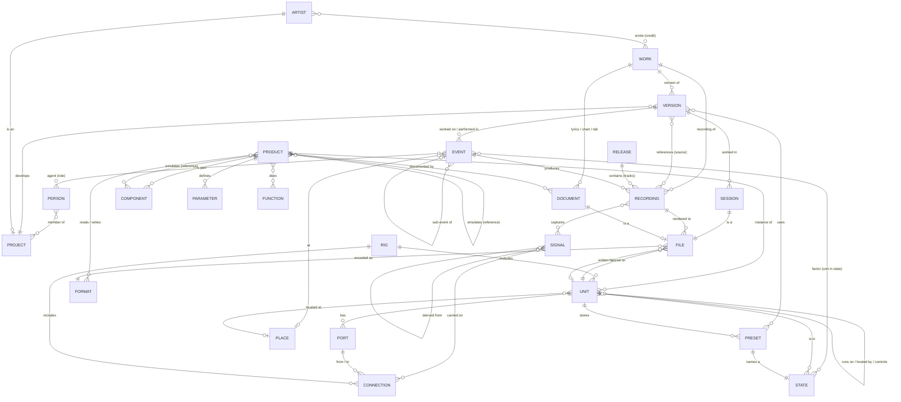

# Studio Model

> **Status:** draft v0.3 (2026-10-11). This is a conceptual model, not a formal schema yet.
> Decisions still open are marked **[Q#]** and collected in [§12 Open questions](#12-open-questions).
>
> **v0.3 changes** (from a review of the [Studio Ontology Framework](../research/papers/Fazekas-Sandler-2011-Studio-Ontology-Framework.md)):
> - **Emulation** is now first-class. An effect or instrument can *emulate* a reference
>   device, which ties presets and settings to a real company, device, revision and year
>   (§6.3).
> - **State**: a device takes part in an activity *in a particular state*. A Preset is a
>   named, saved State (§6.4).
> - **Events** now cover activities as well as occasions: tracking, mixing, bouncing,
>   performing. Each records who did what, when, using what (§5).
> - **Port** now has both a **connector** and a **protocol**. Added **part-of**
>   (components), **named Signals**, and an **effect-type** concept tree.
> - Added two principles: **prescriptive vs descriptive**, and **a signal changes identity
>   when it's transformed**.
>
> **v0.2:** Work / Version / Recording / Performance / Release music layer; ontology method (§4).

## 1. Purpose

This repo is the agentic context for the studio. Claude Code and other agents use it for
workflows, automation, research, and session prep. To do that well, an agent needs to know:

- **what exists**: works, projects, devices, software, files;
- **what each thing can do**: generate, process, route, record, convert, and what it
  *emulates*;
- **how things are connected**: signal paths, hosting, control;
- **what state things were in**: settings and presets, now and at past sessions;
- **what happened**: who tracked, mixed or played what, when, and using what;
- **where the data lives**: files, formats, drives, cloud folders.

This document defines a **common vocabulary and a set of entities** for that knowledge. The
studio combines several systems (Logic, Ableton, UAD, Boss pedals, notation tools, Google
Drive), and each one names the same ideas differently. The model gives them one set of
concepts, with every system's words attached.

### The core idea: cascading semantic input into execution

The point of the model is to take **semantic input**, meaning what a musician or engineer
says, and **cascade it into real technical execution** on *this* studio's specific surface:
its devices, software, routing and control APIs. Every part of the model is a stage in that
cascade.

```text
 "Abbey Road reverb on the vocal"            semantic input
        │  resolve words: SKOS reference layer, elevated terms, solution glossary  (§4)
        ▼
 Technique → recipe: send → EQ (HPF/LPF) → reverb, 100% wet           intent, in reference terms
        │  realize against this studio's graph: Units, Ports, buses,
        │  constraints, live State                                       (§6, inventory)
        ▼
 Console AUX 1 → EQ insert → Pure Plate; vocal channel aux send        realization
        │  translate to solution terms and operations                    (§4.1a glossary)
        ▼
 UA Mixer Engine: set aux send level, insert plug-ins                  execution surface
        │  read back the live state
        ▼
 verify → record a descriptive Event (what was done, with what, in what State)
```

**Kinds of semantic input** (all seen in our discussions so far):

| Kind | Example | Resolves through | Lands as |
|---|---|---|---|
| **Kind of thing** | "put a compressor on the vocal" | reference concept → owned Products of that kind | an insert / Unit |
| **Elevated name** | "an 1176", "Autotune" | elevated `alt` label → concept *or* product | an insert / Unit |
| **Character / style** | "1176-style", "make it more Motown" | traits of a reference device or technique | Products / States with those traits |
| **Named setting / sound** | "the Autotune effect", "all buttons in" | a State in the reference device's terms → `parameter_map` | parameter values on an owned emulation |
| **Named technique** | "Abbey Road reverb", "NY compression on the drums" | Technique recipe → steps | routing + inserts + settings |
| **Monitoring intent** | "track vocals on in-ears with more drums" | monitor mix (listener, transducer, blend) → preferred realization | monitor-mix outputs, mirror, sends, a submix on a virtual channel |
| **Relative change** | "more me", "less verb", "brighter" | the current State + a direction | a parameter delta |
| **Work / session context** | "set me up for Arbitrary Overlord" | Work → Version → Session, presets, rig | open the files, recall states, check drives |
| **Diagnostic** | "why can't I hear myself in the in-ears?" | trace the graph + read live state + constraints | an explanation, plus a proposed fix |
| **Musical position** | "on the chorus", "from bar 33" | Version structure → session timeline | a time-scoped Event (automation, program change) |

**Execution needs safety rails** that are part of the cascade, not extras: confirm before
writing, a dry run that shows the planned operations, read-back to verify, undo (keep the
prior State), and a descriptive Event for every run. The execution surfaces actually found on
this studio, and how far each has been tested, are tracked in the
[inventory](inventory.md#execution-surfaces).

### What we intend to do with it

1. **Settle the vocabulary and entities.** That's this document.
2. **Create canonical records** in the repo, one home per entity, plus a vocabulary file of
   concepts and their labels (§4). Each top-level folder gets a short README saying what
   lives there and what's canonical.
3. **Rewrite `CLAUDE.md`** as a real system prompt for the repo: what the studio is, where each
   entity lives, the source-of-truth rules, the conventions, the vocabulary, and the tools to
   use.
4. **Later:**
   - a formal schema and a validation script;
   - a `kb` store over the records;
   - a graph of the studio, so an agent can answer "what can the studio do" and "how does
     signal get from A to B";
   - drift checks that compare declared state against what the machine reports;
   - workflow skills such as `/session <song>`.

### Example questions the model should answer

- "Set up the Mac for a session on Arbitrary Overlord." (Work → Version → Session file →
  Storage unit mounted? → apps and presets)
- "Why is there no vocal in Logic?" (trace Connections from the mic to the Logic input)
- "How do I get this `.gp5` into Logic as MIDI?" (Format conversion path through Products)
- "What can I control over MIDI on the VE-500?" (Product → Parameters → MIDI mapping →
  manual)
- "Which onemanband covers use the VE-500 harmony, and in what key?" (Version → Preset →
  State)
- "Which reference recordings and MIDI did I start the Killing Moon cover from?" (Version →
  source Recordings and Documents)
- "Is the plugin I'm reading about the version I actually have?" (Product vs installed Unit)
- "Do I have an 1176, real or virtual?" (concept `fet-compressor` → reference Product
  `ua-1176` → everything that emulates it → owned Units)
- "This tutorial says 4:1 on an 1176 with input at 24. Set that up on what I've got."
  (a State in the reference device's terms, mapped onto an emulation's Parameters)
- "What was the GM-800 set to when I tracked the guitar on 10/6?" (Event → factors → State)
- "Did I record the DI or the wet guitar?" (Recording → captured Signal → derived from)
- "Are the speakers on?" The agent understands that "speakers" means the studio monitors
  (§4).

---

## 2. Principles

- **One canonical home per entity.** Every fact has exactly one place where it is declared.
  Everything else links to it. This follows the existing song-doc rule ("this doc wins over
  session notes and the Logic project").
- **One concept, many words.** Each concept has one precise preferred term, used in records
  and queries, plus the everyday words you actually say and the words vendors use (§4). The
  agent stores precisely and talks naturally.
- **Align with existing standards where they exist.**
  - Music entities: MusicBrainz and DDEX/RIAA practice (Work vs Recording).
  - Vocabulary: SKOS.
  - Devices, connectivity, state and signal: the Studio Ontology and Music Ontology.

  We borrow terms and structure; we don't adopt the full specs.
- **Declared vs observed** is about *state*.
  - A *declared* fact is what we say is true: the song is in C♯m, input 4 is the guitar.
  - An *observed* fact is what a tool reported at a moment in time: a Logic session
    snapshot, `system_profiler`, an editor dump.
  - Observations are dated and never overwrite declarations. A mismatch is **drift** to
    resolve.
- **Prescriptive vs descriptive** is about *process*.
  - A *prescriptive* record is a plan or template: the live-rig plan, an Ableton set's
    program-change track, a `/session` skill, a mixing checklist.
  - A *descriptive* record says what actually happened: a session log, a bounce, a gig.
  - Both are Events (§5); a field says which kind.
- **A signal changes identity when it's transformed.** The clean DI guitar and the GM-800 wet
  output are *different signals*, even though one came from the other. Wiring (Connections)
  and what happened to which signal (Signals and Events) are two parallel views of the same
  setup.
- **Every claim carries a confidence.** This reuses the field-notes markers:

  | Marker | Meaning |
  |---|---|
  | ✅ `documented` | stated in a manual or official docs |
  | 🔶 `inferred` | worked out, not stated directly |
  | 🧪 `tested` | confirmed on this rig (with date) |
  | ❓ `to-test` | open; should be checked |
  | 🏷 `observed` | read from the machine (settings, logs, files), with date |

- **Intent vs realization.** Model *what* a setup is for separately from *how* it's
  routed. For example, a monitor mix (listener, transducer, blend), "record a DI and an amp
  track", or "send the click only to the drummer". The studio can usually realize an intent
  in many ways:
  - **possible** realizations are *derived* from the graph and constraints, never written
    down;
  - the **preferred** realization per scenario *is* recorded, as prescriptive state.
- **Ports have one owner at a time.** A hardware output claimed by one mechanism (on UA: a
  monitor-mix mirror, Flex Routing, or an alt-monitor assignment) is no longer available to
  others, such as the DAW. The agent checks ownership before routing.
- **Capacity is a constraint, not a detail.** Products have budgets that trade off against
  each other: on UA, monitor mixes vs virtual channels within the driver's I/O channel count,
  and DSP for plug-ins. Realizations must fit the budget.
- **Function over category.** Things are described by what they *do*, using a small verb list
  ([§7](#7-functions)). One product can do several things.
- **Not pedantic.** Model only what helps answer real questions. A property earns its place
  when a workflow needs it.

---

## 3. Overview

The model has three layers, plus two cross-cutting views:

- **Music**: abstract things we make and play, like works, versions, recordings, and
  performances.
- **Infrastructure**: things that *do* something, like devices, software, components,
  connections, places, and what they emulate.
- **Data**: files and formats. This is where the two layers meet: sessions, recordings and
  documents are files that infrastructure reads and writes.
- **Events and State** (cross-cutting): what happened, and the state each device was in when
  it did.
- **Vocabulary** (cross-cutting, §4): the concepts and the words attached to them.



---

## 4. Vocabulary and ontology method

### 4.1 Method

We use a lightweight version of **SKOS** (Simple Knowledge Organization System), the W3C
standard for controlled vocabularies. Each **concept** has:

| Field | Purpose | Example (headphones) |
|---|---|---|
| `id` | stable key used in records | `headphones` |
| `pref` | the precise preferred term, one per concept | headphones |
| `alt` | everyday words you actually say | cans, phones |
| `hidden` | misspellings and legacy spellings: matched in searches, never used in replies. Vendor terms go in the solution glossary (§4.1a), not here | hedphones, head phones |
| `definition` | one sentence | Over- or on-ear output transducer for a single listener |
| `broader` / `narrower` | hierarchy | broader: `output-transducer` |
| `related` | sideways links | `headphone-output` (the port that feeds them) |
| `match` | the same concept in an external *standard* (MusicBrainz, DDEX, Music Ontology, Studio Ontology). Vendor terms are not standards: they go in the solution glossary (§4.1a) | |
| `scope_note` | when to use it and when not | "IEMs are a separate concept" |

**How the agent uses it:**

- **Records and queries use `id` / `pref`.** Records always say `output-transducer` or
  `studio-monitor`, never "speakers".
- **Conversation uses `alt`.** When you say "speakers", the agent resolves it to
  `studio-monitor` (or `pa-speaker` in the live rig). It replies in your words unless precision
  matters.
- **Searches expand to all labels and narrower concepts.** A search for "patch" also hits
  `preset` and Boss "patch" pages. A search for "compressor" also hits FET, VCA and opto
  compressors, and everything that emulates one (§6.3).
- **Ambiguous words get resolved, not guessed.** "Patch", "channel", "track" and "recording"
  each map to several concepts. The agent picks one from context, or asks.

The vocabulary will live in one file: a TOML registry, for example `model/vocabulary.toml`.
This document lists the starting concepts. **[Q10]**

### 4.1a Two layers: reference and solution architecture

The vocabulary has two layers (Tim's framing, from his work practice):

| Layer | What it holds | Form | Grounding |
|---|---|---|---|
| **Reference layer** | Generic nouns and verbs of the domain, independent of any product: main mix, monitor mix, submix, preset, compressor, port, record, mix | **SKOS** concepts: one preferred term, *many* alternative and everyday terms, broader/narrower, related | A long history: studio practice, standards (MusicBrainz, the Studio Ontology), usage across vendors |
| **Solution-architecture layer** | A specific device's or program's own terms: UA *Cue*, *MONITOR*, *Cue Mirror to*, *Virtual*; Logic *Summing Stack*, *Groups*; Ableton *Group Track*; Boss *Patch* | A plain **glossary**, *not* SKOS. Each term is **exact**: one term, one meaning, no synonyms | **The product's manual.** If it's in the manual, we know it's that product's vocabulary, so a citation is required |

**Why SKOS only at the reference layer.** SKOS exists to manage fuzzy vocabularies: many
words for one idea, hierarchies, everyday versus formal usage. Solution vocabulary has none
of that. The manual fixes each term's meaning, so it needs no alternative labels and no
confidence markers, just its source.

**Solution terms can look identical to reference terms.** UA's "Mute" or Logic's "Bus" may be
spelled like the generic word. They are still product-scoped terms, because their meaning
comes from that product's manual. They map to the reference concept with the relation
`same`.

**Solution glossary entry:**

| Field | Purpose |
|---|---|
| `term` | Exactly as the manual writes it ("Cue Mirror to", "Summing Stack") |
| `product` | The Product (or product family) whose manual defines it |
| `meaning` | What it means there, quoted or closely paraphrased from the manual |
| `source` | Manual file and section or line (**required**) |
| `maps_to` | One or more reference concepts, each with a relation |

**Relations from solution terms to reference concepts:**

| Relation | Means | Example |
|---|---|---|
| `same` | The meanings coincide | UA *MONITOR* → main mix; Boss *Patch* → preset; Ableton *Group Track* → submix |
| `close` | Nearly the same; differs in stated edge cases | UA *Cue* → monitor mix (with MIX lit, a cue output carries the main mix) |
| `narrower` | A specific kind of the reference concept | Logic *Summing Stack* → submix (a submix implemented as a track stack) |
| `broader` | More general than the reference concept | |
| `related` | Associated but different | UA *Aux* → submix (an effects return, not a performer mix) |
| `implements` | A mechanism that realizes the concept | UA *Cue Outputs*, *Cue Mirror to* → delivering a monitor mix to outputs |

**Rules:**
- **Records and queries use reference concepts.** Product facts (live state, settings,
  manual citations) use that product's exact terms.
- **Reasoning crosses layers through `maps_to`.** To realize "a monitor mix for the wedge",
  the agent goes from `monitor mix` to UA *Cue* (close: check the MIX switch), then *Cue
  Mirror to* (implements) to reach the hardware outputs.
- **Searches expand both ways.** A reference concept's labels plus every solution term that
  maps to it.
- **Elevated terms live in both layers.** Vendor words often become common language:
  "cue" for a monitor mix, "an 1176" for a FET compressor, "Auto-Tune" for pitch
  correction, "a Leslie" for a rotary speaker, "Pultec-style" for a passive EQ. That's fine,
  because the whole vocabulary is a **query surface**. The everyday usage becomes an `alt`
  label on the reference concept, and the exact vendor term stays in the solution glossary
  with its manual citation. A query for "1176" matches both: the concept (any FET
  compressor) and the product term (the UA 1176 emulations). The agent picks one from
  context, or offers both.
- **An elevated term can resolve to three kinds of thing.** It isn't always a concept:

  | It may mean | Example | Resolves to |
  |---|---|---|
  | **a kind** | "an Autotune on the vocal" (any pitch correction) | reference concept (`pitch-correction`) |
  | **a setting or sound** | "the Autotune effect" (hard, fast retune: the robotic sound) | a State or Preset in the reference device's terms (§6.4) |
  | **a character** | "1176-style" (fast attack and release, aggressive grab), even on a non-FET compressor | **traits** of the reference device (§6.3) |

  "X-style" and "X-like" phrasings usually mean character. When it matters, the agent should
  say which reading it took.
- **A term with no manual can't enter the solution layer.** That product goes to the parking
  lot until its manual is mirrored.
- **Choosing a preferred reference term is a judgement call,** made with the person who uses
  it. Industry usage is evidence, not the rule ("monitor mix" was chosen over "cue mix").
- **The same layering already appears elsewhere in the model:**
  - effect type (reference) vs a product's emulation (solution);
  - Product (catalogue) vs Unit (your instance).

```toml
# sketch of the two layers in files

# reference layer: SKOS
[concept.monitor-mix]
pref = "monitor mix"
alt  = ["headphone mix", "wedge mix", "IEM mix", "cue mix", "foldback"]

# solution layer: exact glossary, manual-grounded
[[term]]
term    = "Cue"
product = "uad-console"
meaning = "A cue mix bus plus its output assignment; each output has MIX, MONO and (rack units) Mirror settings"
source  = "data/manuals/controllers-interfaces/UAD-Console/18-cues.md"
maps_to = [{ concept = "monitor-mix", relation = "close" }]
```

### 4.2 Prior art to align with

| Standard | Covers | How we use it |
|---|---|---|
| [MusicBrainz](https://musicbrainz.org/doc/How_to_Use_Works) | Work, Recording, Release, Artist, Event, Place, Instrument | Main source for music entity names and the "recording of" relationship |
| DDEX / RIAA practice | Musical Work vs Sound Recording, ISWC / ISRC | Confirms the Work/Recording split; identifiers later if anything gets released |
| [SKOS](https://en.wikipedia.org/wiki/Simple_Knowledge_Organization_System) | Concepts and labels | The vocabulary method above |
| [Studio Ontology Framework](https://archives.ismir.net/ismir2011/paper/000086.pdf) (Fazekas & Sandler, ISMIR 2011; [local copy](../research/papers/Fazekas-Sandler-2011-Studio-Ontology-Framework.md)) | Devices, state, components, connectivity, signal and event flows, effects, mixers, multitrack | Main source for the infrastructure layer (mapping below) **[Q11]** |
| Music Ontology | Work → performance → sound → recording → signal; events with agents and factors | The event model and Signal; the library-cataloguing layers (FRBR: Work → Expression → Manifestation → Item) |

**What we borrow from the Studio Ontology and Music Ontology:**

| Their term | Our term | Notes |
|---|---|---|
| `device:Device`, `PhysicalDevice`, `AbstractDevice` | Product / Unit, `embodiment` | Abstract devices include software *and models of physical devices*, hence `emulates` |
| `device:Service` | Function (§7) | |
| `device:State`, `Configuration` | **State** (§6.4) | Preset = a named, saved State |
| `device:component` | **Component** (`part_of`) | |
| `con:Terminal` | **Port** | "terminal" becomes a `hidden` label |
| `con:Connector`, `con:Protocol` | `connector`, **`protocol`** on Port | |
| Electrical / Optical, Analog / Digital terminal | `medium`, `domain` on Port | |
| `mo:Signal` | **Signal** (named) | New identity after each transform |
| Event, sub-event, agent, factor | **Event** | Activities as well as occasions |
| Recording, Mixing, Transform events | Event kinds `record`, `mix`, `transform` | |
| `MusicalWork` | Work | |
| `mo:Recording` (an *event*) | Event kind `record` | ⚠ Our *Recording* is the MusicBrainz sense: the resulting audio |
| AudioEffect / Model / Implementation / EffectDevice | effect-type concept / reference Product + `emulates` / — / Product | We skip the implementation layer (circuits, algorithms) |
| Mixer: Channel, Bus, InsertTerminal | Later extension | Console and DAW mixer internals |
| Multitrack: Project, Track, Clip; Edit events | Later extension | Session internals |
| Timelines (physical, musical, media time) | Later extension | Wall clock vs bars/beats vs position in the audio |

### 4.3 Starting concepts: signal, data, and connections

The studio's manuals name the same ideas differently. Term counts across the Logic, UAD,
LUNA, Ableton, Boss and pedal manuals showed:

- **"signal"** is universal. It appears thousands of times, as "audio signal", "signal flow",
  "signal type".
- **"media"** almost never means signal. In Logic it means the Media Browser or media files;
  elsewhere it's nearly absent. We don't use it.
- **endpoint words split by world.** Boss and pedal makers say **jack**. DAWs say
  **input/output**, and **port** for MIDI.
- **"patch"** means three things: a Boss preset, a Logic channel-strip setting, and a cable
  connection.

| Concept (`pref`) | Definition | `alt` (everyday) | `hidden` (vendor, ambiguous) |
|---|---|---|---|
| **signal** | Something that flows in real time. A *named* Signal (§6.6) is one specific signal, such as "guitar DI". Types: `audio`, `midi`, `control`, `clock`, `video`, `data` | sound, feed | media |
| **audio domain** | `analog` or `digital` | | |
| **audio level** | `mic`, `instrument`, `line`, `speaker`, `headphone` | | Hi-Z (= instrument) |
| **control signal** | Non-MIDI control: expression, footswitch, CTL, CV | expression, footswitch | CTL, EXP |
| **port** | An endpoint on a Unit where a Connection attaches | input, output, in, out | jack, socket, terminal |
| **connector** | The physical form of a port: `ts`, `trs`, `xlr`, `combo`, `din5`, `trs-midi`, `usb-c`, `usb-b`, `usb-micro`, `thunderbolt`, `toslink`, `bnc`, `gk13`, `speakon`, `virtual` | quarter-inch, XLR, MIDI cable | connector |
| **protocol** | What a port speaks over its connector: `analog-unbalanced`, `analog-balanced`, `aes3`, `aes42`, `spdif`, `adat`, `wordclock`, `midi-1`, `midi-2`, `usb-audio`, `usb-midi`, `thunderbolt-audio`, `gk-13pin`, `gk-serial`, `expression`, `footswitch` | | |
| **connection** | A link from one Port to another (physical cable or virtual route) | cable, hookup, routing | patch (cabling sense), route |
| **bus** | A virtual route *inside* a Unit (DAW aux, Console bus, VE-500 USB bus) | aux, send | |
| **component** | A part of a device: a processing block, a mode, a module, firmware, a hosted plugin slot | block, section, mode, engine | |
| **parameter** | A named, settable control on a Product or Component | knob, setting, control | |
| **state** | The values of a Unit's parameters at a moment | settings, where it was set | configuration |
| **preset** | A named, saved State | patch, sound, setting | program, scene, snapshot, channel strip setting, rig, tone model |
| **emulation** | A Product or Component that models a reference device | model, emulation, clone, "a 1176" | circuit model, capture, profile, IR |
| **file** | Data at rest | | |
| **format** | How a file is encoded: `wav`, `mp3`, `mid`, `musicxml`, `gp5`, `logicx`, `pdf`, `md`… | file type | |
| **content** | What a file is about: `audio`, `performance`, `notation`, `words`, `project`, `preset` | | media type |
| **midi channel** / **mixer channel** | Always qualified | channel | channel (bare: ambiguous) |
| **track** (DAW) | A lane in a Session | track | *also* a Release track (§4.4): ambiguous |

> **Connector ≠ protocol.** The same TRS jack can carry balanced line audio, TRS-MIDI or an
> expression pedal. One micro-USB port on the VE-500 carries USB audio *and* USB MIDI. The
> GK-5 speaks `gk-serial`, while older GK pickups speak `gk-13pin`. Compatibility ("can this
> plug into that?") means checking protocol, level and channel count, not just the plug.

### 4.4 Starting concepts: music

| Concept (`pref`) | Definition | `alt` (everyday) | `match` |
|---|---|---|---|
| **work** | The composition: melody, harmony, lyrics. Independent of any recording | song, tune, composition | MusicBrainz Work; DDEX/RIAA Musical Work; MO MusicalWork |
| **recording** | The fixed audio that results from recording or mixing a Work: one specific mix or edit | track, mix, bounce, demo, take-it-home mp3 | MusicBrainz Recording; DDEX Sound Recording; FRBR Expression. ⚠ *not* `mo:Recording`, which is the event |
| **performance** | Playing a Version live, as an Event | playing it live, the gig version | MO Performance |
| **release** | A published package of Recordings: album, EP, single | album, record, EP | MusicBrainz Release; FRBR Manifestation |
| **version** | *Our* take on a Work, developed by a Project, that produces Recordings and/or Performances | our version, the cover | — (studio-specific; a plan, not a realisation) |
| **cover** (narrower of version) | A Version of a Work someone else wrote | cover | MusicBrainz "cover" attribute |
| **arrangement** | A *derivative Work*: new musical material such as reharmonization, re-orchestration or a new part | arrangement, chart | MusicBrainz "arrangement of" (Work → Work) |
| **artist** | Who is credited: as writer of a Work, or performer of a Recording / Performance | band, act, songwriter | MusicBrainz Artist |
| **project** (narrower of artist) | An Artist that is *you*, alone or with others | band, project | — |
| **event** | Something that happened, or is planned, at a time: an occasion (gig, rehearsal, session day) or an activity (tracking, mixing, bouncing) | gig, session, take, mix pass | MusicBrainz Event; MO / Event Ontology Event |

> **Why "arrangement" isn't the per-project entity.** In industry and copyright usage, an
> arrangement creates new musical material, which makes it a derivative work. A cover keeps the
> Work's melody and fundamental character and changes the interpretation: key, tempo, feel,
> instrumentation. Most of what we do is the second, so the per-project entity is **Version**.
> A real arrangement is recorded as a Work → Work relationship.

### 4.5 Starting concepts: device kinds

Category is a concept hierarchy, so "speakers" and "headphones" resolve properly. This is a
partial tree to extend.

```text
transducer
├── input-transducer
│   ├── microphone          alt: mic
│   │   ├── dynamic-microphone
│   │   ├── condenser-microphone
│   │   └── ribbon-microphone
│   └── pickup              alt: pickups
│       ├── magnetic-pickup
│       ├── piezo-pickup
│       └── divided-pickup  alt: hex pickup, GK pickup   hidden: GK-5, 13-pin
└── output-transducer       alt: speakers, headphones (the everyday words for the whole class)
    ├── studio-monitor      alt: speakers, monitors, nearfields
    ├── pa-speaker          alt: PA, mains, speakers (live rig)
    ├── headphones          alt: cans, phones           hidden: PHONES
    └── in-ear-monitor      alt: IEMs, in-ears          scope: "IEM mix" is a bus, not this
instrument
├── physical-instrument     alt: guitar, piano, drums
└── software-instrument     alt: synth, VI, plugin      hidden: AU instrument, VSTi
effect-device               alt: pedal, plugin, FX, outboard   (kind of effect: see §4.6)
amplifier                   alt: amp, head, combo
preamp                      alt: pre, channel strip     hidden: Unison preamp
interface                   alt: audio interface, the Apollo
controller                  alt: MIDI controller, keyboard, footswitch, foot controller
computer
storage                     alt: drive, the RAID, the X5
daw                         alt: DAW, Logic, the session
editor                      alt: editor app                hidden: librarian
```

### 4.6 Starting concepts: effect types

The *kind of effect* is separate from any device. A pedal, a plugin, a VE-500 block and a
Logic mode can all be the same kind. These concepts are also the bottom of every
emulation chain (§6.3). The tree is partial and can grow.

```text
dynamics
├── compressor              alt: comp
│   ├── fet-compressor      alt: FET, "an 1176"
│   ├── vca-compressor      alt: VCA, "an SSL bus comp", "a dbx 160"
│   ├── opto-compressor     alt: opto, "an LA-2A"
│   └── variable-mu-compressor  alt: vari-mu, tube compressor, "a Fairchild"
├── limiter
├── gate / expander
└── de-esser
equalizer                   alt: EQ
├── parametric-eq
├── graphic-eq
└── passive-eq              alt: Pultec-style
time-based
├── delay                   alt: echo
│   ├── tape-delay
│   ├── analog-delay        alt: BBD
│   └── digital-delay
└── reverb                  alt: verb
    ├── plate-reverb
    ├── spring-reverb
    ├── room-reverb / hall-reverb
    └── convolution-reverb  alt: IR reverb
modulation                  alt: mod
├── chorus · flanger · phaser · tremolo · vibrato · rotary
drive                       alt: dirt, gain
├── boost · overdrive · distortion · fuzz
amp-simulation              alt: amp sim, amp model, cab sim, IR
pitch                       alt: harmony, pitch shift, octave, auto-tune
├── harmonizer · pitch-correction · octaver · whammy
filter                      alt: wah, envelope filter
```

---

### 4.7 Starting concepts: mixing and monitoring

These are reference-layer (SKOS) concepts, settled with Tim on 2026-10-11. The UA, Logic,
Ableton and Boss terms that map onto them are in the solution glossary in the
[first-pass notes](inventory-first-pass.md#33-monitor-mixes-on-the-ua-system).

| Concept | Definition | Everyday words (`alt`) |
|---|---|---|
| **main mix** | The control-room mix that feeds the main monitors | main mix, control room, the speakers |
| **monitor mix** | A distinct mix sent to a **different transducer** from the main mix (headphones, a wedge, in-ears). It can, and often does, carry a **different blend of the DAW's playback** (and live inputs) than the main mix. How it's built is implementation | headphone mix, cans mix, wedge mix, IEM mix, cue mix, foldback |
| **monitor send** | A channel's level, pan and mute into one monitor mix | send to the cans |
| **mono sum** | Left and right summed to mono | mono, fold to mono |
| **alt monitors** | An alternate speaker pair the main mix can switch to | B speakers, alt speakers |
| **virtual channel** | A mixer input strip fed from the computer instead of a physical input (UA's word, but also the common one; no older generic term) | virtual, DAW return |
| **submix** | Several tracks or channels mixed into a group with a purpose (drums, vocals, guitars…) that isn't the main mix. "Subgroup" is a synonym: same semantics, different word | subgroup, drum bus, vocal bus |
| **stem** | A submix rendered to an audio file | stems |
| **VCA group** | Channels whose faders and controls are linked, **without** summing audio | VCA, DCA, linked faders |

**Decisions and guards:**
- **"Monitor mix", not "cue mix".** "Cue" is UA's word and the older studio term, so it stays
  as an `alt` label. "Monitor mix" is Tim's everyday word.
- **The bare word "monitor" means the main mix.** UA labels the main control-room mix and its
  outputs MONITOR. So "monitor" alone and "MONITOR outputs" mean the main mix, while "monitor
  mix" always means a performer's mix.
- **Bare "group" is ambiguous** between `submix` and `VCA group`. Resolve it from context.
- **The traditional-studio picture:** on a studio console, you aux out different mixes of the
  playback (plus live inputs) to different headphone mixes or submixes, one per performer or
  destination. Monitor-mix systems such as UA Console's are that job, as dedicated buses.
- **Rejected:** "playback submix" (nobody says it). The idea is covered by monitor mix plus
  submix.

---

## 5. Music entities and events

Each entity gets an `id`, which is a lowercase slug (`arbitrary-overlord`, `boss-ve-500`). That
matches the existing song-doc and bounce naming. The property lists show what matters, not a
final schema.

### How the music entities fit together

```text
Work ──(version of)── Version ──worked on in──► Events (record, mix, bounce) ──produce──► Recording ──► Release
 │                      │   └──performed in──► Event (performance, at a gig)
 │                      └── references ──► source Recordings / MIDI / charts
 └── recording of ◄── every Recording (yours and the original artist's)
```

**A cover, step by step.** You start from the Work "The Killing Moon" (written by Echo & the
Bunnymen) and their Recording, perhaps with some MIDI. Once you load that into a Session and
start changing it, you've created a **Version**: onemanband's cover. That Version is then either
**performed** (a performance Event at a gig) or **recorded** (record and mix Events produce a
Recording, which may go on a Release). The original Recording stays linked to the Version as
a **reference**.

**An original works the same way.** The Work "Arbitrary Overlord" (written by you / Hot Fog)
has a Hot Fog Version, which has produced several Recordings: the riff idea, the first demo,
the rough mix, and the Tim and band mixes.

**Alignment with the library-cataloguing layers** (FRBR, used by the Music Ontology):

| FRBR / Music Ontology | Ours |
|---|---|
| Work (`MusicalWork`) | Work |
| — | Version (a plan for realising the Work; no counterpart in their model) |
| Performance event → sound | Event kind `perform` |
| Recording / mixing event → signal (Expression) | Event kinds `record` / `mix` → **Recording** |
| Manifestation (the published record) | Release |
| Item (a copy) | File |

### Work

The composition, independent of who plays it or how.

| Property | Notes |
|---|---|
| `title` | current title |
| `title_history` | working titles and aliases, with dates (e.g. `alluminium-sister` / `alluminum-sister`) |
| `original` | `true` if written by you or one of your projects |
| `writers` | → Artist / Person, with roles: `composer`, `lyricist` |
| `documents` | → Document: lyrics, chord charts, tab |
| `derived_from` | → Work, only for a real arrangement |

### Version

Our take on a Work, developed by one Project. This is where the musical specifics live, and
it's what most studio workflows act on. A cover is a Version of someone else's Work. **[Q2]**

Examples:
- Hot Fog's Arbitrary Overlord (Drop C♯, 115/180).
- onemanband's "Car" (Built to Spill). Its four charts, `car`, `car-capo1`, `car-capo3` and
  `car-halfstepdown`, are either alternatives inside one Version or separate Versions.
  **[Q12]**

| Property | Notes |
|---|---|
| `work`, `project` | |
| `kind` | `original` or `cover` (derived from `work.original`) |
| `status` | `idea`, `demo`, `arranging`, `tracking`, `mixing`, `done` (as in the song docs) |
| `key`, `tuning`, `capo`, `tempo`, `time_signature` | tempo may be a map of sections |
| `structure` | sections with bars and tempo changes |
| `references` | → source Recordings, MIDI files and charts the Version started from |
| `sessions` | → Session |
| `events` | → Events that worked on or performed it |
| `recordings` | → Recordings produced from it |
| `presets` | → Preset (e.g. VE-500 harmony key per song) |
| `documents` | → Document, for version-specific charts |

### Recording

The audio that results from recording and mixing a Work: **one specific mix or edit**,
following MusicBrainz. A new mix is a new Recording. That matches how the song docs already
list them, one row per mix. Recordings by other artists that we use as references are
Recordings too.

The Recording is the *result*. The act of tracking or mixing is an Event that produces it, and
the mp3s and wavs are its Files.

| Property | Notes |
|---|---|
| `work` | recording of |
| `version` | → Version, for our own recordings |
| `produced_by` | → Event (the mix or bounce that made it) |
| `captures` | → Signals, for raw tracks and stems ("guitar DI", "GM-800 wet") |
| `performers` | → Artist / Person credits |
| `date`, `tag` | following the bounce naming `<slug>_<YYYY-MM-DD>_<tag>` |
| `kind` | `rehearsal`, `idea`, `demo`, `rough-mix`, `mix`, `master`, `stems`, `live`, `reference` |
| `files` | → File (may exist in several places: Drive, iCloud, RAID) |
| `isrc` | only if released |

### Event

Something that happened, or is planned, at a time. Events cover two things:

- **Occasions:** a gig, a rehearsal, a session day.
- **Activities within them:** tracking a vocal, an overdub, a mix pass, a bounce, changing a
  preset, performing a song.

Activities are **sub-events** of an occasion. Each Event records **who** (agents, with
roles), **what** (the Version, the input and output Signals and Recordings), **when**,
**where**, and **using what** (factors: the Units involved and the State each was in).

| Property | Notes |
|---|---|
| `kind` | occasions: `gig`, `rehearsal`, `session-day`. Activities: `perform`, `record`, `overdub`, `edit`, `mix`, `bounce`, `master`, `transform`, `configure` (a state change), `practice` |
| `mode` | `descriptive` (it happened) or `prescriptive` (planned or a template) |
| `time` | wall-clock time; for planned changes, a musical position (bar 33) |
| `place` | → Place |
| `version` | → Version |
| `agents` | → Person, with role: `performer`, `engineer`, `mixer`, `producer` |
| `factors` | → Unit with its State (§6.4), e.g. GM-800 in state X |
| `inputs` / `outputs` | → Signals, Recordings, Files |
| `sub_events` | → Event |
| `session` | → Session, if it happened in a DAW project |

Examples:
- A Hot Fog **session day** on 2026-10-06, with sub-events: a `record` of guitars and a `mix`
  pass.
- A onemanband **gig**, with one `perform` sub-event per song (the **setlist**), each with
  `configure` sub-events for the program changes the Ableton set sends at given bars
  (prescriptive).
- The **bounce** on 2026-05-07 that produced the `timmix` Recording.

The existing session-notes snapshots and the bounce log are informal Event records already.

### Release

A published package of Recordings. Example: Hot Fog's third album (untitled).

| Property | Notes |
|---|---|
| `title`, `project`, `status`, `date` | `status`: `planned`, `in-progress`, `released` |
| `tracks` | → ordered Recordings |

### Artist

Who is credited: as writer of a Work, or as performer of a Recording or Performance. Most
Artists are lightweight: a name and maybe a link (Echo & the Bunnymen, Built to Spill, Joy
Division).

### Project

An Artist that is *you*, alone or with others: Hot Fog, Club Business, Logjams, onemanband.
It's an Artist (so credits work the same way for yours and everyone else's), plus the studio
context that only your own projects need. **[Q1]**

| Property | Notes |
|---|---|
| `name`, `aliases` | |
| `members` | → Person |
| `status` | `active`, `dormant`, `archived` |
| `releases` | → Release |
| `storage` | Drive folders, Logic project folder, etc. |
| `rig` | default Rig, e.g. onemanband → `live-one-man` |

### Person

A human: you, bandmates, collaborators. A Person can be a member of a Project, can be credited
directly (as a writer, or for a mix), and takes roles in Events.

| Property | Notes |
|---|---|
| `name`, `roles` | e.g. Donny: demos in the Song Ideas folder |
| `projects` | → Project |
| `contact` | only if a workflow needs it (e.g. sending bounces) **[Q3]** |

### Document

Written content about a Work, Version or Product. Lyrics and notation are both Documents.
What a Document holds is described by **facets**, not separate types.

| Facet | Example |
|---|---|
| `words` | lyric sheet |
| `chords` | chord chart (usually with `words`) |
| `tab` | ASCII tab, `.gp5` |
| `staff` | MusicXML, score |
| `performance` | MIDI |
| `structure` | section map |
| `reference` | manual, field notes, research |

| Property | Notes |
|---|---|
| `about` | → Work, Version, or Product |
| `facets` | list from the table above |
| `canonical` | `true` for the version that wins (e.g. the Google Doc lyrics) |
| `file` or `url` | → File, or an external link (Google Doc, Obsidian) |
| `confidence` | for reference docs: manual vs field notes |

### Session

A DAW project file in which a Version is worked on. Its internals (tracks, regions, takes)
are a later extension, following the Studio Ontology's multitrack model.

| Property | Notes |
|---|---|
| `version` | |
| `daw` | → Product (Logic, Ableton, LUNA) |
| `file` | → File (e.g. `/Volumes/Samsung_X5/Hot Fog/arbitrary-overlord.logicx`) |
| `alternative` | Logic project alternative in use (e.g. `arb-overlord-feb`) |
| `snapshots` | dated observations: tempo, tracks, running apps, plugin states |

---

## 6. Infrastructure and data entities

### 6.1 Product

A *kind* of thing that exists in the world, hardware or software. Manuals, capabilities,
parameters, supported formats and MIDI implementations belong here.

A Product doesn't have to be something you own. **Reference products**, the real devices that
plugins and models emulate, are Products with no Units, such as the original 1176 (§6.3).

| Property | Notes |
|---|---|
| `name`, `vendor`, `model`, `aliases` | |
| `year`, `revision`, `variant_of` | mostly for reference products: `ua-1176-rev-a` is a revision of `ua-1176` |
| `embodiment` | `physical` or `software` |
| `kind` | → device-kind concept (§4.5) and/or effect-type concept (§4.6) |
| `functions` | → [§7 Functions](#7-functions) |
| `emulates` | → reference Product, with `emulation_kind` (§6.3) |
| `components` | → Component (§6.2) |
| `parameters` | → Parameter (§6.4) |
| `plugin_formats` | software: `au`, `vst3`, `aax`, `uad-native`, `unison`, `standalone` |
| `reads` / `writes` | → Format |
| `port_template` | the Ports every unit of this product has |
| `control_surfaces` | how it can be controlled from outside: `midi-pc`, `midi-cc`, `sysex`, `mcu`, `hui`, `applescript-ui`, `websocket`, `cli`, `editor-app` |
| `documents` | → Document (manuals, field notes) |
| `documented_version` | the version the manual describes |
| `constraints` | fixed assignments and budgets the agent must respect, e.g. UA: ALT 1/2 → line 1-2 / 3-4; monitor mixes vs virtual channels share the driver's I/O channel count |

### 6.2 Component

A part of a device. A component can be:
- a processing block: VE-500 input, vocal-FX and mixer stages;
- a mode: Logic Compressor's circuit types;
- a module or engine: GM-800 synth engines;
- firmware;
- a hosted plugin slot, such as Unison preamps on the Apollo.

Components can nest, and can have their own `kind`, `parameters` and `emulates`. This matters
because a single plugin often contains several emulations. For example, Logic Compressor's
Circuit Type buttons "choose the type of circuit emulated by Compressor": Platinum Digital,
Studio VCA and FET, Classic VCA, and Vintage VCA, FET and Opto. ✅ ([Effects guide, line
3232](../../data/manuals/daw-video/logic-pro-mac-effects-user-guide.md#L3232)). These are generic
circuit types, not named devices, so they emulate effect-type *concepts* rather than
reference Products.

| Property | Notes |
|---|---|
| `part_of` | → Product or Component |
| `name`, `kind` | |
| `parameters`, `emulates` | as for Product |

### 6.3 Emulation

**Emulation** connects software, models and captures to the real devices they imitate, and
through them to a company, a device, a revision and a year. A chain runs from the general to
the specific:

```text
dynamics ─► compressor ─► fet-compressor                       ← effect-type concepts (§4.6)
                               ▲ kind
                     ua-1176  (Universal Audio, 1967)          ← reference Product
                               ▲ variant_of
                     ua-1176-rev-a  "blue stripe"              ← reference Product (revision)
                               ▲ emulates (licensed-model)
                     UAD 1176 Rev A plugin                     ← Product you own (Unit: installed)
                               ▲ instance of
                     your install, in state {ratio: 4, input: 24, …}
```

So "an 1176 plugin" is, at once:
- a `compressor`;
- more specifically, a `fet-compressor`;
- more specifically still, an emulation of the Universal Audio 1176 blue stripe.

Its presets and settings sit in that device's terms.

| Property (on the `emulates` link) | Notes |
|---|---|
| `target` | → reference Product (or only an effect-type concept, when the model is generic) |
| `emulation_kind` | `licensed-model` (endorsed circuit model), `inspired-by` (unofficial, often oblique names), `capture` (a profile of one specific unit at one setting, e.g. ToneX), `impulse-response` (a cab or space), `sample-based` (a recorded instrument, e.g. Superior Drummer kits) |
| `captured_state` | for captures: the State of the original unit when it was captured |
| `parameter_map` | the emulation's Parameters → the reference device's controls |
| `confidence` | vendor claim vs inferred |

**Traits** (on the reference Product). These are the characteristics people mean by
"X-style": what the device is known for, separate from what kind of device it is.

| Property | Notes |
|---|---|
| `traits` | Short, reusable descriptors: e.g. `ua-1176`: fast attack, fast release, aggressive / forward, "all buttons" mode; `teletronix-la-2a`: slow, smooth, program-dependent release; Auto-Tune (as a sound): fast retune, hard pitch quantize |
| `known_for` | Classic uses or records (research context) |
| `source` | Where each trait comes from: the vendor's emulation manual (e.g. the UAD Plug-Ins Manual's history sections), a lookup, or Tim |

Traits are themselves reference-layer concepts (`fast-attack`, `program-dependent-release`,
`hard-tune`), so any product can share them. "Find me something 1176-style that isn't an
1176" becomes: the 1176's traits → other Products or States with those traits.

**Why it matters:**

- **Search by sound, not product.** "Do I have an opto compressor?" finds hardware, plugins,
  Console inserts and Logic modes.
- **Settings travel.** A State written in the reference device's terms ("1176: 4:1, input 24,
  attack 3, release 7") can be applied to *any* emulation that has a `parameter_map`.
- **Context comes for free.** The reference Product carries the company, year, history, and
  the classic records it's known for, which helps research and presets.
- **One emulation can have several implementations** with different hosts. UA ships many
  emulations both as **UAD DSP** plugins (running on Apollo/Satellite chips, hostable in
  Console) and as **UAD Native** plugins (running on the Mac's CPU, DAW only). Same reference
  device and `parameter_map`, different host and latency.
- **It covers instruments too.** Amp models (GM-800, ToneX, the OX's speaker models), piano
  modelling (FP-30X), and sampled drum kits are all emulations.

### 6.4 Parameter, State and Preset

**Parameter.** A named, settable control on a Product or Component.

| Property | Notes |
|---|---|
| `name`, `range`, `unit`, `default` | e.g. Ratio: 4, 8, 12, 20, all; Attack: 1–7 |
| `midi` | how to set it remotely: CC number, NRPN, SysEx address (from the MIDI Implementation docs) |
| `maps_to` | → the reference device's control, for emulations |

**State.** The values of a Unit's (or Component's) parameters at a moment: what it was *set
to*. This includes unsaved tweaks, which a Preset alone can't capture.

| Property | Notes |
|---|---|
| `of` | → Unit or Component |
| `values` | parameter → value; can be partial ("only what matters") |
| `based_on` | → Preset, plus `modified: true/false` |
| `at` | → Event, or a timestamp |
| `source` | `declared` (written down), `observed` (editor dump, SysEx dump, plugin state in a session, screenshot, photo of the knobs) |
| `confidence` | |

**Preset.** A named, saved State, stored in a device slot or a file.

| Property | Notes |
|---|---|
| `state` | → State |
| `unit` or `product` | user preset vs factory preset |
| `name`, `number` | `number` = program change number where relevant |
| `vendor_term` | patch, program, scene, snapshot, rig, tone model |
| `stored_in` | device slot, plugin preset file, editor backup → File |
| `versions` | → Versions that use it |

**State changes are Events** (`configure`). That covers a program change in the live set at
bar 33, a mix automation move, and "I switched the GM-800 to patch 12 and lengthened the
delay". A chain of state changes over time is how a session gets recalled.

### 6.5 Unit

A specific instance you have (or plan to have). Wiring, location, status and state attach to
the **Unit**. For software, a Unit is an *install* on a computer. **[Q4]**

| Property | Notes |
|---|---|
| `product` | |
| `status` | `owned`, `planned`, `wishlist`, `loaned`, `retired` |
| `serial`, `firmware`, `installed_version` | version drift = `installed_version` ≠ product `documented_version` (e.g. MG3 3.0.55 vs 3.0.74) |
| `runs_on` | software → computer Unit |
| `hosted_by` | plugin → DAW Unit, Console, or standalone |
| `controls` | e.g. VE-500 Editor → VE-500; Launchkey → Ableton |
| `located_at` | → Place |
| `rigs` | → Rig |
| `ports` | from the product template, plus local names ("Apollo input 4") |
| `presets` | → Preset |
| `current_state` | → State (declared or last observed) |
| `nickname` | what you call it, if different ("the X5") |

### 6.6 Signal

A **named signal** at a point in the setup. Signals give the event view something to talk
about. The wiring says what's connected; Signals say *which audio* is flowing, and what it
came from.

| Property | Notes |
|---|---|
| `name` | e.g. `guitar-di`, `gm800-wet`, `ve500-vocal`, `iem-mix` |
| `type` | `audio`, `midi`, `control`… |
| `produced_by` | → Port / Unit / Component |
| `derived_from` | → Signal(s): a transform creates a new Signal |
| `carried_on` | → Connections |
| `channels` | mono, stereo |

**Example.** The guitar's `guitar-di` goes into the Apollo. The GM-800's output is
`gm800-wet`, derived from the guitar. The VE-500's `ve500-vocal` is derived from the mic and
contains no guitar (OUTPUT L/R). A Logic track records one of these, so "did I record the DI
or the wet?" has an answer. **[Q13]**

### 6.7 Port

An endpoint on a Unit. The Studio Ontology calls it a *terminal*.

| Property | Notes |
|---|---|
| `unit`, `name` | the vendor's label: "OUTPUT L", "INPUT 4", "MIDI IN" |
| `direction` | `in`, `out`, `bidirectional` |
| `connector` | the physical form (§4.3); `virtual` for software ports |
| `protocols` | what it speaks over that connector: one or several (§4.3) |
| `signal_types` | `audio`, `midi`, `control`, `clock`, `video`; may be several (USB) |
| `medium` | `electrical`, `optical`, `virtual` |
| `audio_domain`, `audio_level` | for audio ports |
| `channels` | mono, stereo, multichannel count |

### 6.8 Connection

A link from one Port to another: the edges of the studio graph.

| Property | Notes |
|---|---|
| `from`, `to` | → Port |
| `protocol` | the one in use, when the ports support several |
| `medium` | `physical`, `virtual`, or `rf` (wireless, e.g. an IEM transmitter → bodypack) |
| `via` | passive intermediates in the run, e.g. mic → **snake** box → snake tail → interface input. The snake is a Unit with no functions beyond `route` |
| `cable` | connector pair and length, optional **[Q5]** |
| `midi_channel` | for MIDI links |
| `rig` | → Rig |
| `confidence` | declared, observed, tested |

Virtual connections use the same entity. Examples: Apollo Console → Logic input, IAC bus,
Logic aux sends, and MG3 → a synth hosted inside MG3. Mixer internals (channels, inserts,
sends and returns) are a later extension.

### 6.9 Rig

A named configuration: a set of Units and Connections in use together, with each Unit's
default State. The same Unit can be in several Rigs and wired differently in each. Examples:
`studio`, `live-one-man`. **[Q6]**

### 6.10 Place

Where a physical Unit sits, or where an Event happens. Places nest: room → desk / rack /
shelf / pedalboard / stand. This is the "furniture and structures" layer.

### 6.11 File

Data at rest.

| Property | Notes |
|---|---|
| `path` or `url` | |
| `format` | → Format |
| `content` | `audio`, `performance`, `notation`, `words`, `project`, `preset`, `reference` |
| `stored_on` | → Unit whose kind is `storage` (Samsung_X5, RAID, Mac Studio SSD, Google Drive, iCloud) |
| `written_by` | → Unit (Logic, Guitar Pro, VE-500 Editor…) |
| `copies` | other locations of the same file |

### 6.12 Format

An encoding. Products declare which formats they `read` and `write`. That gives a **conversion
graph**: getting from `.gp5` to a Logic MIDI region is a path search. This builds on
[music-formats/investigation.md](../research/music-formats/investigation.md).

| Property | Notes |
|---|---|
| `id`, `extensions` | `musicxml`: `.xml`, `.mxl` |
| `content` | what it can hold |
| `text_readable` | can an agent read it directly, or does it need a converter (e.g. `scripts/midi_dump.py`)? |

### 6.14 Technique

A **named, reusable recipe**, often named after the person, studio or label that made it
famous: the Abbey Road reverb trick, New York compression, the Motown trick, the Decca Tree,
the Glyn Johns method, the Wall of Sound. It's **prescriptive**: a template for Events, and
the same intent-vs-realization split used for monitor mixes. The Studio Ontology calls these
prescriptive workflows; its `MicrophoneArrangement` (e.g. Decca Tree) is one kind. Seed log:
[research/named-techniques.md](../research/named-techniques.md).

| Property | Notes |
|---|---|
| `name`, `aliases` | elevated names are `alt` labels ("NYC trick", "NY compression") |
| `kind` | `processing` (EQ/compression/reverb chains), `mic-technique`, `arrangement` / `tracking` approach |
| `generic` | → reference concept it specializes, e.g. NY compression → `parallel-compression` |
| `origin` | people, place (studio), label, era |
| `recipe` | steps in reference terms: send → EQ (HPF/LPF) → reverb (100% wet); or a mic layout; or an arrangement rule |
| `result` | → traits ("punch", "air", "wide image, solid centre") |
| `realizations` | how this studio can do it: derived from the graph; preferred ones recorded (e.g. Console AUX → EQ → Pure Plate) |

### 6.13 Tool

Something in *this repo* that acts on the model: scripts, skills, kb stores, MCP servers.

| Property | Notes |
|---|---|
| `path`, `kind` | `script`, `skill`, `kb-store`, `mcp` |
| `reads` / `writes` | which entities or files it touches |
| `run` | e.g. `uv run scripts/sync_bounces.py` |

---

## 7. Functions

These are verbs describing what a Product does. The Studio Ontology calls them *services*. A
Product can have several. Like every concept, each function has everyday words attached.

| Function | Meaning | Everyday (`alt`) | Examples |
|---|---|---|---|
| `generate` | makes sound or notes | play, make sound | guitars, FP-30X, TD-17, Kontakt, Superior Drummer |
| `transduce` | acoustic/physical ↔ electrical | mic it, listen on the speakers / headphones | mics, pickups, GK-5, monitors, headphones |
| `convert` | analog ↔ digital, audio → MIDI | pitch-to-MIDI, AD/DA | Apollo AD/DA, GM-800 pitch-to-MIDI, MIDI Guitar 3 |
| `process` | modifies a signal (what kind: §4.6) | effects, FX, treat | pedals, VE-500, UAD plugins, soothe2 |
| `route` | sends a signal somewhere | patch, send, hook up | interfaces, ES-8 switcher, DAW mixers, cables |
| `mix` | sums signals | mix, blend | UAD Console, DAWs, VE-500 mixer stage |
| `control` | sends commands, not content | trigger, switch, automate | MPK249, Launchkey, footswitches, expression pedals, editor apps |
| `record` | captures over time | track, record, loop | Logic, LUNA, Ableton, RC-1, HeadRush |
| `play` | plays back over time | play back | DAWs, loopers, media players |
| `measure` | analyses a signal | meter, tune | Youlean Loudness Meter, VU meters, tuners |
| `host` | runs or contains other Units | run, load | Mac Studio, Logic, Apollo (Unison/DSP), MIDI Guitar 3 (hosts synths) |
| `store` | holds files | save, back up | Samsung_X5, ThunderBay RAID, Google Drive, iCloud |
| `author` | reads and writes song data | write, chart, tab out | Guitar Pro, Scaler, Google Docs, Logic score editor |
| `document` | describes another thing | look it up | manuals, field notes |

`emulate` is deliberately *not* a function. It's a relationship to a reference device
(§6.3), and works alongside whatever the product does (`process`, `generate`).

---

## 8. Relationships (summary)

| From | Relationship | To |
|---|---|---|
| Artist / Person | wrote (composer, lyricist) | Work |
| Work | derived from (arrangement) | Work |
| Project | develops | Version |
| Version | version of | Work |
| Version | references | Recording, Document (sources) |
| Version | worked on / performed in | Event |
| Version | worked in | Session |
| Version | uses | Preset |
| Event | produces | Recording |
| Event | sub-event of | Event |
| Event | agent (role) | Person |
| Event | factor (in state) | Unit + State |
| Event | input / output | Signal, Recording, File |
| Recording | recording of | Work |
| Recording | captures | Signal |
| Release | contains | Recording |
| Project | is an | Artist |
| Person | member of | Project |
| Work / Version / Product | described by | Document |
| Unit | instance of | Product |
| Product / Component | part of | Product / Component |
| Product / Component | emulates | Product (reference) or effect-type concept |
| Product | variant of | Product |
| Product / Component | defines | Parameter |
| Parameter | maps to | Parameter (reference device's control) |
| Unit | is in | State |
| Preset | names a | State |
| Product | does | Function |
| Product | reads / writes | Format |
| Unit | runs on / hosted by / controls | Unit |
| Unit, Event | located at | Place |
| Unit | has | Port |
| Connection | from / to | Port |
| Signal | derived from | Signal |
| Signal | carried on | Connection |
| Rig | includes | Unit (with default State), Connection |
| File | encoded as | Format |
| File | stored on / written by | Unit |
| Session / Document | is a | File |
| Recording | rendered to | File |
| Tool | reads / writes | any entity or File |
| Technique | specializes / produces | reference concept / traits |
| Technique | realized by | Products + routing (a prescriptive Event) |
| *any concept* | broader / narrower / related | concept (§4) |

---

## 9. Worked examples

These are illustrative and use facts already in the repo. Real records come in step 2.

### Effect pedal: Boss VE-500

```yaml
product: boss-ve-500
embodiment: physical
kind: effect-device        # vocal processor
functions: [process, mix, convert, control]
control_surfaces: [midi-pc, midi-cc, editor-app]
components: [input-stage, vocal-fx (lead-fx, multi-fx, reverb, harmony…), mixer]   # field notes §1
ports:                     # port names from the Owner's Manual panel diagram
  - { name: MIC IN,       direction: in,  connector: xlr,       protocols: [analog-balanced],   audio_level: mic }         # phantom power available
  - { name: INST INPUT,   direction: in,  connector: ts,        protocols: [analog-unbalanced], audio_level: instrument }  # drives HARMONY/VOCODER chord detection
  - { name: INST THRU,    direction: out, connector: ts,        protocols: [analog-unbalanced], audio_level: instrument }  # guitar passes through to amp/pedals
  - { name: OUTPUT L,     direction: out, connector: xlr,       protocols: [analog-balanced],   audio_level: line }        # guitar is NOT in this output
  - { name: OUTPUT R,     direction: out, connector: xlr,       protocols: [analog-balanced],   audio_level: line }
  - { name: USB,          direction: bidirectional, connector: usb-micro, protocols: [usb-audio, usb-midi] }
  - { name: MIDI IN,      direction: in,  connector: din5,      protocols: [midi-1] }                                     # program change + tempo sync
  - { name: CTL 1, 2/EXP, direction: in,  connector: trs,       protocols: [footswitch, expression] }
internal_buses: [xlr-bus, usb-bus]   # the mixer stage builds both
documents: [Boss-VE-500-Owners-Manual, Boss-VE-500-Parameter-Guide, Boss-VE-500-MIDI-Implementation, Boss-VE-500-Field-Notes]
controlled_by: [boss-ve-500-editor]
```

### Emulation: "an 1176"

🔶 These are illustrative. Check the plugin names and details against what's actually
installed when seeding.

```yaml
# reference products (not owned)
- product: ua-1176
  vendor: Universal Audio
  year: 1967
  kind: fet-compressor
  parameters: [input, output, attack, release, ratio]   # ratio buttons 4/8/12/20
- product: ua-1176-rev-a
  variant_of: ua-1176
  aliases: ["blue stripe"]

# what you own: one plugin per emulation, plus a mode inside a stock plugin
- product: uad-1176-rev-a
  embodiment: software
  kind: fet-compressor
  emulates: { target: ua-1176-rev-a, emulation_kind: licensed-model }
- product: logic-compressor
  components:
    - { name: "Vintage FET", kind: fet-compressor, emulates: { target: fet-compressor, emulation_kind: inspired-by } }

# a setting written once, in the reference device's terms
state:
  of: ua-1176
  values: { ratio: 4, input: 24, output: 20, attack: 3, release: 7 }
  source: declared        # e.g. from a tutorial
```

The agent can apply that State to any installed Unit whose Product `emulates` the 1176 and has
a `parameter_map`. For a generic emulation like "Vintage FET", it can approximate the State and
say so.

### Event + State: tracking guitar (studio rig)

```yaml
event:
  kind: record
  mode: descriptive
  time: 2026-10-06
  version: arbitrary-overlord@hot-fog
  session: arbitrary-overlord.logicx (alt: arb-overlord-feb)
  agents: [{ person: tim, role: performer }, { person: tim, role: engineer }]
  factors:
    - { unit: gm-800,  state: { based_on: "patch 12", modified: true, values: { delay.time: 420ms } } }   # illustrative
    - { unit: apollo-x8, state: { input-4: { preamp: unison-?, gain: ? } } }
  inputs:  [guitar-di]
  outputs: [{ recording: track "Guittim", captures: [guitar-di] }]
```

### Software instrument: a synth hosted in MIDI Guitar 3

```yaml
product: midi-guitar-3
embodiment: software
kind: software-instrument
functions: [convert, host, generate]     # audio → MIDI, hosts synths
plugin_formats: [au, standalone]
documented_version: 3.0.74
unit:
  installed_version: 3.0.55             # drift, observed 2026-10-03
  runs_on: mac-studio
  hosted_by: logic-pro
ports:
  - { name: audio in,  direction: in,  connector: virtual, signal_types: [audio] }
  - { name: midi out,  direction: out, connector: virtual, signal_types: [midi] }
  - { name: audio out, direction: out, connector: virtual, signal_types: [audio] }
```

### A connection chain and its signals: clean guitar into Logic (studio rig)

```text
wiring:   guitar ─(ts, analog-unbalanced)→ Apollo x8 INPUT 4 ─(virtual)→ UAD Console ch 4 ─(virtual)→ Logic audio track
                                                                                           └─(virtual)→ MIDI Guitar 3 (AU) → synth
signals:  guitar-di ──────────────────────────────────────────────────────────────────────────────► recorded on "Guittim"
                    └─(MG3 convert)→ mg3-midi ─(synth generate)→ mg3-synth-audio
```

Each wiring arrow is a Connection with `rig: studio`. A MIDI cable would be the same thing,
with `connector: din5`, `protocol: midi-1`, `medium: physical`.

### Original: Arbitrary Overlord

```yaml
work:
  id: arbitrary-overlord
  original: true
  writers: [{ artist: hot-fog, role: composer }]   # or tim
  documents:
    - { facets: [words], canonical: true, url: "Google Doc: Arbitrary Overloard" }
version:
  id: arbitrary-overlord@hot-fog
  project: hot-fog
  kind: original
  status: demo
  key: C#m
  tuning: [C#, G#, C#, F#, A#, D#]
  tempo: { intro: 115, main: 180 }
  sessions: [{ daw: logic-pro, file: "/Volumes/Samsung_X5/Hot Fog/arbitrary-overlord.logicx", alternative: arb-overlord-feb }]
  documents:
    - { facets: [performance], file: midi/arbitrary-overlord.mid }
    - { facets: [staff], file: midi/arbitrary-overlord-score.xml }
recordings:                 # one per mix, as in the song doc; each produced by a record/mix/bounce Event
  - { date: 2011-06-26, kind: rehearsal, tag: riff-idea }
  - { date: 2025-11-14, kind: demo }
  - { date: 2026-01-26, kind: rough-mix, tag: RUFF }
  - { date: 2026-02-27, kind: mix, tag: tm, by: tim }
  - { date: 2026-02-28, kind: mix, by: band }   # + stems
  - { date: 2026-05-07, kind: mix, tag: timmix, by: tim }
```

### Cover: The Killing Moon (onemanband)

```yaml
work:
  id: the-killing-moon
  original: false
  writers: [{ artist: echo-and-the-bunnymen, role: composer }]
version:
  id: the-killing-moon@onemanband
  project: onemanband
  kind: cover
  status: idea
  references:
    - { recording: "Echo & the Bunnymen – The Killing Moon (1984)", kind: reference }
  documents:
    - { facets: [words], file: music/one-man-band/the-killing-moon/lyrics.md }
  presets: [{ unit: ve-500, purpose: harmony, state: { harmony.key: "?" } }]
events: []                 # performances once it's played live
```

---

## 10. Where things live today

*Updated 2026-10-11 after the repo reorganization.*

| Entity | Current home | Gap |
|---|---|---|
| Project | `music/<project>/` (`hot-fog`, `one-man-band`), each with a `README.md` | No project records yet for Club Business, Logjams |
| Work / Version | `music/<project>/<song>/<song>.md` (frontmatter song doc) | Work and Version are still one doc per folder. Fine while each Work has one Version |
| Document (lyrics, tab) | `lyrics.md` and chord / tab files in each song folder; Google Docs (Hot Fog lyrics) | Covers have two lyric copies where both existed (`lyrics.md` and the chart file) |
| Recording | Recordings table in song docs, filled by `scripts/sync_bounces.py` | Hot Fog only; reference recordings for covers aren't tracked |
| Event | `session-notes.md` snapshots, bounce rows, `docs/studio/rigs/one-man-band-live-rig.md` (prescriptive, planned) | Informal; no who/using-what |
| Session | Song doc `logic:` block, `session-notes.md` snapshots | |
| Release | Song doc `album:` field | No Release records |
| Product (docs) | `data/manuals/sources.toml`, category `INDEX.md` | Only products that have a manual |
| Unit / Port / Connection / Rig / Scenario | `data/inventory/*.toml` (pilot: UA system and monitoring) | Pedalboard, MIDI, controllers not yet structured |
| Parameter | Parameter Guides, MIDI Implementation docs (e.g. VE-500) | Not extracted |
| State / Preset | UA engine (live), Console `.uadmix` files, VE-500 Editor, Logic sessions | Read on demand; not stored |
| Emulation / reference products | UAD manual (plugin histories) | Missing |
| Signal | MG3 and VE-500 field notes (prose) | Not named |
| Place | `place` fields in `data/inventory/` | Mostly `"?"` |
| Format | `docs/research/music-formats/investigation.md` | Not tied to Products |
| Technique | `docs/research/named-techniques.md` (seed log) | |
| Tool | Each script's docstring, `kb/README.md`, `.claude/skills/` | No index |
| Vocabulary | Model §4; the solution glossary in `docs/studio/inventory-first-pass.md` §3.3 | No vocabulary file yet |

---

## 11. Roadmap

1. **This document**: agree on entities, properties, vocabulary.
2. **Vocabulary file**: move §4's concepts into the registry, and grow it from the manuals
   (vendor terms become `hidden` labels).
3. **Record format and location.**
   - Proposed format: Markdown with YAML frontmatter, one file per Product/Unit, Work,
     Version and Project. This matches the song docs, and `kb/frontmatter.py` already parses
     it, so records are searchable for free.
   - One file per Rig, holding its Connections table.
   - TOML for registries (vocabulary, as with `sources.toml`). **[Q7]**
4. **Seed the inventory.**
   - Draft records from what the repo knows, and mark gaps for you to fill (mics, guitars,
     cables, what's plugged in where).
   - Read observable facts off the machine: audio/MIDI devices, installed plugins and versions,
     mounted volumes.
5. **Seed emulations.**
   - Build reference products and `emulates` links for the installed plugins and amp/effect
     models. The UAD manual's plugin histories are a good first source.
   - Extract Parameters from the Parameter Guides and MIDI Implementation docs, starting
     with the VE-500.
6. **Anchor READMEs** in each top-level folder: what's here, what's canonical, who writes it.
7. **`CLAUDE.md` rewrite**, including the "store precisely, talk naturally" vocabulary rule.
8. **Formal schema, validation script, kb store, graph export, drift checks, workflow skills.**
9. **Later extensions**, from the Studio Ontology:
   - mixer internals: channels, inserts, sends and returns, automation;
   - session internals: tracks, regions, takes, edits;
   - timelines: wall clock vs bars/beats vs position in the audio;
   - microphone details: polar pattern, stereo arrays.

---

## 12. Open questions

Each question lists the current default, which this draft assumes until it's changed.

- **[Q1] Project vs Artist.** *Default:* a Project *is an* Artist (so credits work the same for
  everyone), plus studio context (members, storage, rig). Cover artists are plain Artists.
- **[Q2] "Version" as the name for our take on a Work.** *Default:* Version, with `cover` as
  the narrower concept for other people's Works.
- **[Q3] Person records.** Do bandmates need records (for workflows like "send the bounce to
  the band")? *Default:* yes, minimal.
- **[Q4] Product / Unit split.** Keep it, or merge into one Device record until you own two of
  something? *Default:* keep it. It solves planned-vs-owned and version drift, and reference
  products need it.
- **[Q5] Cable inventory.** Are physical cables things you own (length, count), or is "a TRS
  connection exists here" enough? *Default:* connection-level only.
- **[Q6] Rigs.** Is it `studio` and `live-one-man` only, or also rehearsal or portable rigs?
  Is the VG-800 / MOTU M4 live plan current, or has the GM-800 / Apollo setup replaced it?
- **[Q7] Record format.** *Default:* Markdown with frontmatter for entities, TOML for
  registries.
- **[Q8] Wiring granularity.** Port-to-port (Apollo INPUT 4 ← GM-800 OUT L), or chain-level?
  *Default:* port-level for the studio rig, chain-level for anything planned.
- **[Q9] Confidence on every property, or only on Connections and field-note claims?**
  *Default:* only where it matters (Connections, capabilities, versions, emulation claims).
- **[Q10] Vocabulary file.** One `model/vocabulary.toml`, or concepts split by domain (music,
  signal, devices, effect types)? With two layers (§4.1a): reference concepts in one file,
  and solution concepts next to each Product, or in per-product files? *Default:* one
  reference file, plus one solution file per product family (UA, Logic, Boss…) once there are
  more than a handful.
- **[Q11] External ontologies.** How far to align with the Studio Ontology / Music Ontology:
  just borrow terms, or keep `match` links to their URIs? *Default:* borrow terms and
  structure (done in v0.3); add `match` links where cheap.
- **[Q12] Variants inside a Version.** Are `car-capo1` / `car-capo3` / `car-halfstepdown`
  alternative charts within one Version, or separate Versions? *Default:* one Version with
  alternative charts, until they diverge in a Session or a Recording.
- **[Q13] Named signals.** Name every signal, or only the ones that matter for recording and
  troubleshooting (DI vs wet, vocal, IEM mix)? *Default:* only the ones that matter.
- **[Q14] Capturing State.** How much to capture, and how: editor/SysEx dumps, plugin preset
  files, Logic session plugin states, photos of the knobs? Per session, or only when a sound
  is "the one"? *Default:* declared States for presets used in Versions; observed snapshots
  at session start when a tool can read them automatically.
- **[Q17] Techniques as a project.** Keep growing the seed log, or make Techniques
  first-class records with realizations per rig? *Default:* seed log until a workflow needs
  one ("set up NY compression on the drum bus").
- **[Q16] Traits.** How to seed them: from the UAD Plug-Ins Manual's device histories,
  from lookups, or only as you name them ("1176-style", "the Autotune effect")?
  *Default:* only as they come up, with a source on each.
- **[Q15] Depth of emulation chains.** Stop at the model (1176), or go to revisions (Rev A
  blue stripe, Rev E, LN)? *Default:* go to the revision when a product claims one; otherwise
  the model, or only the effect-type concept.
